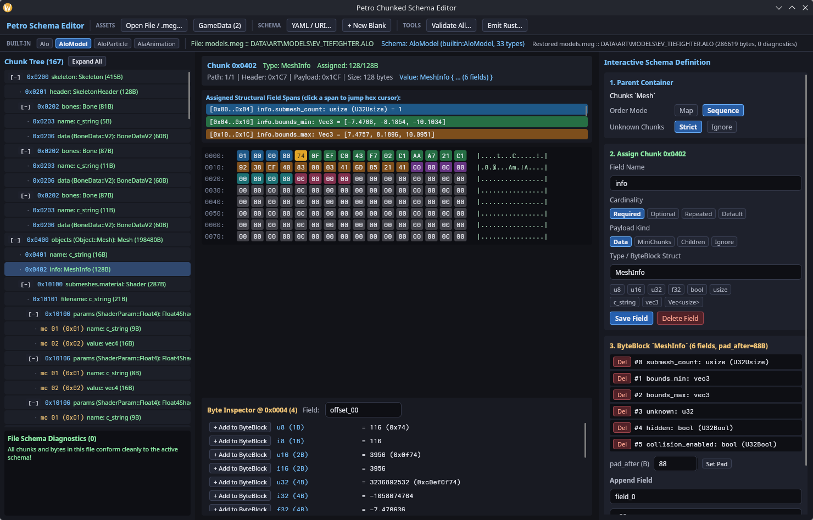
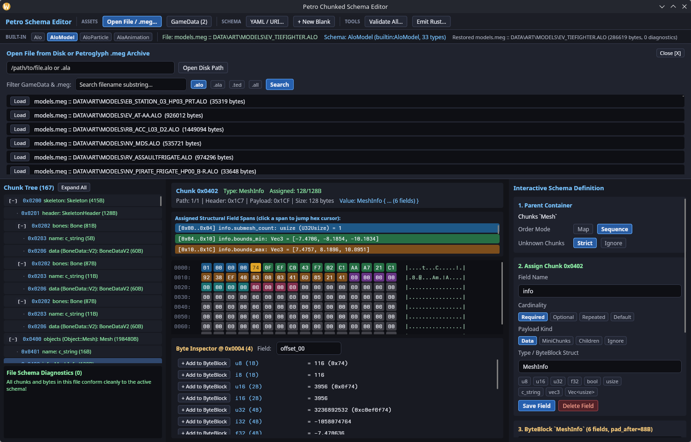
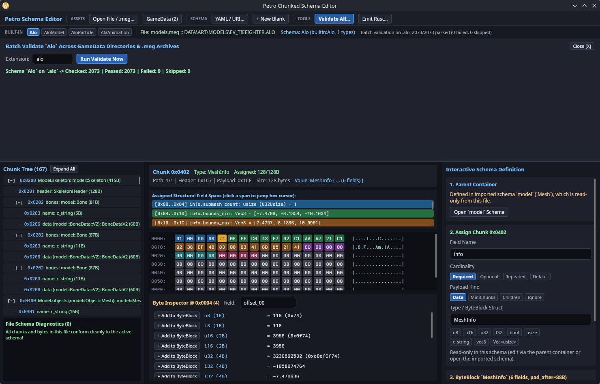

# `petro-chunked-schema-editor`

Interactive [`freya`](https://freyaui.dev/)-based GUI schema editor, binary hex inspector, and CLI batch validator for Petroglyph's chunked binary file formats, built on `petro-chunked-schema` and `petro-meg`.



## Quick CLI Usage

When passed headless flags (`--validate` or `--emit-rust`), the binary runs in CLI mode without opening a window; otherwise it updates saved launch defaults (if supplied) and starts the GUI:

```bash
# Validate every .alo file across loose GameData files and .meg archives using the unified Alo schema
petro-chunked-schema-editor \
  --schema builtin:Alo \
  --game-data "/path/to/GameData/Data" \
  --validate alo

# Emit formatted petro-chunked-derive Rust definitions for a schema to stdout
petro-chunked-schema-editor --schema builtin:Alo --emit-rust

# Load a custom YAML file (use file: to escape literal filenames starting with builtin: or file:)
petro-chunked-schema-editor --schema ./custom.yaml --file ./sample.map
petro-chunked-schema-editor --schema file:builtin:local.yaml --emit-rust
```

---

## UI Tour

### Container Children Overview

Selecting a 32-bit container chunk renders a clickable table of its immediate children (`#`, chunk ID, schema field/type, child kind, byte size/offset, and leaf value preview) alongside radio-style container and field controls.


### Loose File & In-Memory `.meg` Browser

Browse loose files or filter Petroglyph `.meg` archives across configured `GameData` directories by extension and filename substring without extracting archives to disk.



### Batch Validation Across Game Assets

Test any built-in or custom schema over every matching asset across configured `GameData` folders and `.meg` archives—for example validating all 2,073 `.alo` models and particle systems under the combined `builtin:Alo` dispatcher.



### Live `petro-chunked-derive` Rust Code Generation

Inspect and export `prettyplease`-formatted `petro-chunked-derive` Rust definitions (including imported submodules for schemas such as `builtin:Alo`) directly from the active schema.


---

## Top-Down Architecture

### 1. Three-Layer Separation

The binary is organized into three layers so headless validation, schema editing semantics, and rendering stay independent:

```text
  ┌─────────────────────────────────────────────────────────────────────┐
  │ Presentation Layer (`ui/`)                                          │
  │   Toolbar + StatusBar + Modals + 3-Pane Workspace (Freya components)│
  └───────────────┬───────────────────────────────────┬─────────────────┘
                  │ reads / mutates signals           │ reads projections
                  ▼                                   ▼
  ┌───────────────────────────────┐   ┌─────────────────────────────────┐
  │ I/O, Persistence & CLI        │   │ Schema Operations (`editor_ops`)  │
  │ (`cli`, `state`, `gamedata`)  │◄──┤   Tree flattening, span lookup, │
  │   • Builtin & file SchemaRef  │   │   child overview projection,    │
  │   • In-memory .meg reading    │   │   typed field upserts/deletes,  │
  │   • Per-file overrides & JSON │   │   parent-first type creation    │
  └───────────────────────────────┘   └─────────────────────────────────┘
```

1. **I/O, Persistence & CLI (`cli`, `state`, `gamedata`)**
   Resolves schemas via `SchemaRef`, scans `GameData` folders and `.meg` archives purely in memory (`petro-meg`), runs multi-file validation (`run_batch_validation`), and persists session state (`PersistedState`) under XDG config directories—remembering the last file, active `SchemaRef`, unsaved schema draft, `GameData` directories, and per-file `force_plain_data_paths` overrides.

2. **Schema Operations & UI Projection (`editor_ops`)**
   Pure functions translating a parsed `DynamicFile` + `ResolvedSchema` into flat rows for the chunk tree (`build_flat_tree`) and resolved editing context + direct children summaries (`SelectedNodeDetails`, `ChildSummaryRow`, `resolve_selected_node`). Also implements schema edits (`upsert_chunk_field`, `delete_chunk_field`, `upsert_mini_chunk_field`, `delete_mini_chunk_field`, `append_field_to_node_byte_block`, `set_byte_block_pad_after`), automatically inserting new child containers immediately after their parent (`insert_type_after`) and guarding read-only imported nodes (`SchemaId != ROOT`).

3. **Freya Presentation (`ui/`)**
   Declarative dark-themed GUI built from cohesive panes, modals, and shared widgets (`ActionButton`, `SegmentedChip`, `StyledInput`, `ToolbarDivider`, `GroupCaption`).

---

### 2. Freya UI Component & State Architecture

#### State Boundary

Rather than threading dozens of signals through deep prop lists, [`EditorState`](src/ui/context.rs) is created once at the root via Freya's context provider (`use_context_provider`). It owns shared reactive state (`persisted`, `schema`, `resolved_schema`, `dynamic_file`, `selected_tree_path`, `selected_byte_offset`, `active_modal`, `status_msg`, etc.) and exposes semantic domain methods (`open_file`, `load_schema_ref`, `start_blank_schema`, `mutate_schema`, `toggle_force_plain_data`, `select_node`, `jump_to_byte`, `toggle_collapse`).

Transient dialog inputs (search filters, directory text boxes, validation reports, YAML/Rust text buffers) stay encapsulated as local `use_signal` hooks inside each modal component so typing in a modal does not invalidate workspace panes.

#### Component Hierarchy

```text
  app (ui::app)
   ├── Toolbar                      Grouped ASSETS / SCHEMA / TOOLS command bar
   ├── StatusBar                    BUILT-IN schema radio strip + active file/schema/status context
   ├── ModalHost                    Modal backdrop & active modal dispatcher
   │    ├── FileBrowserModal        Browse loose files & in-memory .meg entries across GameData dirs
   │    ├── GameDataDirsModal       Manage GameData directories & auto-detect common installs
   │    ├── BatchValidateModal      Run multi-file validation for an extension and inspect failures
   │    ├── RustCodegenModal        Inspect & save generated petro-chunked-derive Rust source
   │    └── YamlSchemaModal         Edit raw YAML, save to disk, or load by SchemaRef URI
   └── Workspace                    Three-column synchronized inspector & schema editor
        ├── ChunkTreePane           Hierarchical chunk/mini-chunk tree (`ChunkTreeRow`)
        │                           + validation errors (`DiagnosticsPanel`)
        ├── HexInspectorPane        `NodeHeaderBar` + `ContainerOverviewPanel` (for container chunks)
        │                           or `MiniChunkStripPanel` + `SpanLegend` + `HexPaginationBar`
        │                           + color-coded `HexGrid` + `BytePreviewPanel` (for leaf payloads)
        └── SchemaEditorPane        Read-only notice for imports, or live editing cards with radio chips:
                                    `ContainerSettingsCard`, `FieldAssignmentCard`, `ByteBlockEditorCard`
```

---

### 3. Module Map

| Path | Responsibility |
|---|---|
| [`src/main.rs`](./src/main.rs) | Crate entrypoint routing between CLI mode and Freya window launch. |
| [`src/cli.rs`](./src/cli.rs) | `clap` CLI flags (`--schema`, `--file`, `--game-data`, `--validate`, `--emit-rust`) and headless runners. |
| [`src/state.rs`](./src/state.rs) | Session persistence (`PersistedState`), `FileSource` (`Disk` / `MegEntry`), per-file plain-data overrides. |
| [`src/gamedata.rs`](./src/gamedata.rs) | `.meg` + disk discovery, byte loading, `SchemaRef` loading/saving, and `run_batch_validation`. |
| [`src/editor_ops.rs`](./src/editor_ops.rs) | Pure tree flattening, container child overview projection (`ChildSummaryRow`), node resolution, and schema mutation helpers. |
| [`src/ui/mod.rs`](./src/ui/mod.rs) | Root `app` layout initializing `DARK_THEME` and wiring `Toolbar`, `StatusBar`, `ModalHost`, and `Workspace`. |
| [`src/ui/theme.rs`](./src/ui/theme.rs) | Shared dark UI palette tokens, border styles, and color-coded byte span palette. |
| [`src/ui/widgets.rs`](./src/ui/widgets.rs) | Shared styled primitives (`ActionButton`, `SegmentedChip`, `StyledInput`, `ToolbarDivider`, `GroupCaption`). |
| [`src/ui/context.rs`](./src/ui/context.rs) | `EditorState` context provider and domain actions. |
| [`src/ui/toolbar.rs`](./src/ui/toolbar.rs) | Grouped command toolbar (`ASSETS`, `SCHEMA`, `TOOLS`) and built-in radio strip / status bar. |
| [`src/ui/modals/mod.rs`](./src/ui/modals/mod.rs) | Modal host wrapper and shared dialog frame (`ModalFrame`). |
| [`src/ui/modals/file_browser.rs`](./src/ui/modals/file_browser.rs) | `FileBrowserModal` for loose & `.meg` assets. |
| [`src/ui/modals/gamedata_dirs.rs`](./src/ui/modals/gamedata_dirs.rs) | `GameDataDirsModal` for directory configuration. |
| [`src/ui/modals/batch_validate.rs`](./src/ui/modals/batch_validate.rs) | `BatchValidateModal` for batch validation and click-to-open failures. |
| [`src/ui/modals/rust_codegen.rs`](./src/ui/modals/rust_codegen.rs) | `RustCodegenModal` displaying generated Rust code. |
| [`src/ui/modals/yaml_schema.rs`](./src/ui/modals/yaml_schema.rs) | `YamlSchemaModal` for direct YAML editing, saving, and `SchemaRef` loading. |
| [`src/ui/workspace/mod.rs`](./src/ui/workspace/mod.rs) | Three-pane horizontal workspace container. |
| [`src/ui/workspace/chunk_tree.rs`](./src/ui/workspace/chunk_tree.rs) | Left tree view (`ChunkTreePane`, `ChunkTreeRow`, `DiagnosticsPanel`). |
| [`src/ui/workspace/hex_inspector.rs`](./src/ui/workspace/hex_inspector.rs) | Center container children table (`ContainerOverviewPanel`), leaf hex viewer, span highlighting, pagination, and cursor decoder. |
| [`src/ui/workspace/schema_editor.rs`](./src/ui/workspace/schema_editor.rs) | Right schema authoring cards (`ContainerSettingsCard`, `FieldAssignmentCard`, `ByteBlockEditorCard`) and smart wire-format filters. |
