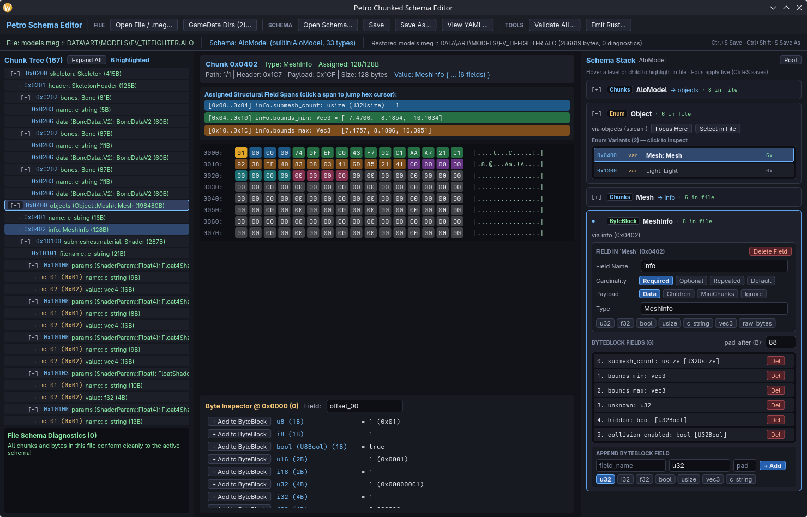
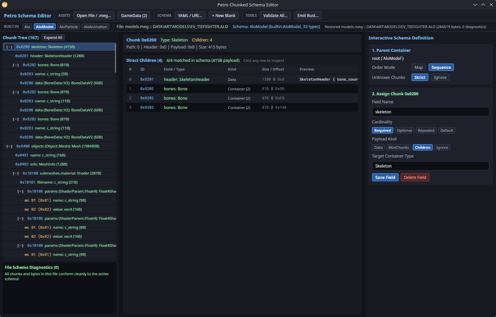
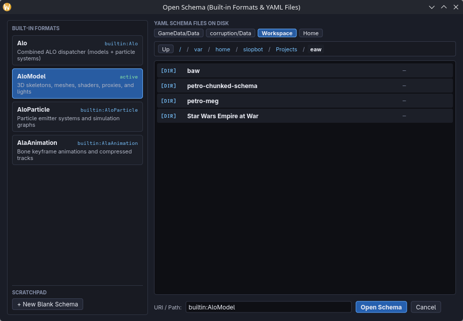
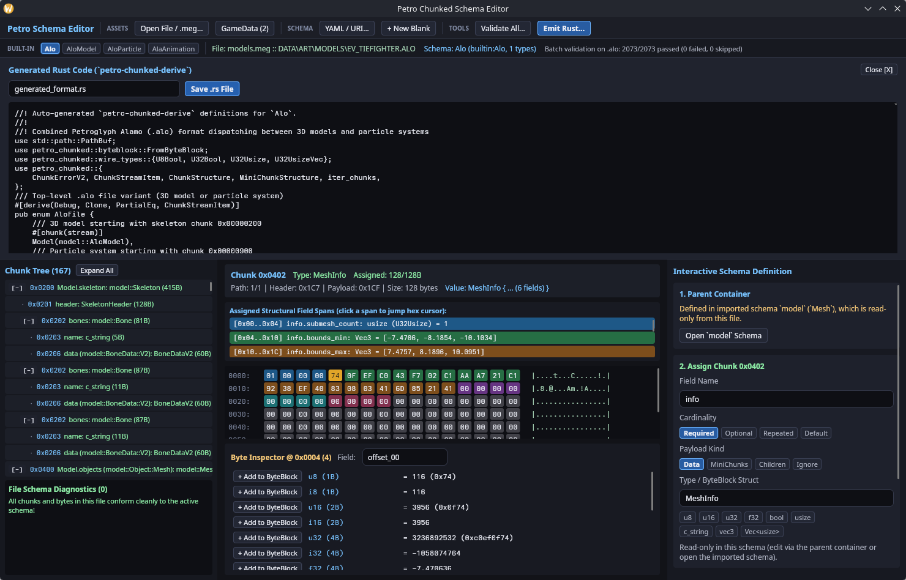

# `petro-chunked-schema-editor`

Interactive [`freya`](https://freyaui.dev/) 0.5 multi-window GUI schema editor, binary hex inspector, and CLI batch validator for Petroglyph's chunked binary file formats, built on `petro-chunked-schema` and `petro-meg`.


## Quick CLI Usage

When passed headless flags (`--validate`, `--emit-rust`, or `--find-strings`), the binary runs in CLI mode without opening a window; otherwise it updates saved launch defaults (if supplied) and starts the GUI:

```bash
# Validate every .alo file across loose GameData files and .meg archives using the unified Alo schema
petro-chunked-schema-editor \
  --schema builtin:Alo \
  --game-data "/path/to/GameData/Data" \
  --validate alo

# Emit formatted petro-chunked-derive Rust definitions for a schema to stdout
petro-chunked-schema-editor --schema builtin:Alo --emit-rust

# Scan a chunked file for whole-block (or + embedded) printable ASCII / ASCIIZ strings
petro-chunked-schema-editor --schema builtin:Alo --file ./sample.alo --find-strings
petro-chunked-schema-editor --file ./sample.alo --find-strings --include-embedded --min-string-len 4

# Load a custom YAML file (use file: to escape literal filenames starting with builtin: or file:)
petro-chunked-schema-editor --schema ./custom.yaml --file ./sample.map
petro-chunked-schema-editor --schema file:builtin:local.yaml --emit-rust
```

### Keyboard Shortcuts

- **`Ctrl+S`**: Save the active schema to its current YAML file (or open the freestanding **Save Schema As** window if editing a built-in or unsaved schema).
- **`Ctrl+Shift+S`**: Open the freestanding **Save Schema As** window.
- **`Ctrl+F`**: Open the freestanding **Find Strings (ASCII / ASCIIZ)** window.
- **`Escape`**: Close the active freestanding dialog window (canceling any pending schema replacement).

---

## UI Tour

### Non-Indenting Schema Stack, Absent Definitions & Hover Synchronization

The right rail mirrors the left file tree as a **non-indenting vertical stack of equal-width cards** from the schema root down to the currently focused level. Ancestor cards stay collapsed by default and can be expanded to inspect **every** defined child field or enum variant—including optional or unrepresented definitions (`0x` in the current file, such as `Light`)—and click to switch levels or edit them live in memory. Hovering any schema level or child row highlights every matching chunk/mini-chunk row across the left-rail `Chunk Tree`.



### Container Children Overview

Selecting a 32-bit container chunk renders a clickable table of its immediate children (`#`, chunk ID, schema field/type, child kind, byte size/offset, and leaf value preview) alongside live auto-applying container and field controls.



### Freestanding Disk & Browse-Into-`.meg` File Browser

Browse local directories and step directly inside Petroglyph `.meg` archives as virtual folders (`models.meg / DATA / ART / MODELS`) with quick places, clickable breadcrumbs, extension filters, and recursive in-`.meg` substring search—without extracting files to disk.


### Unified Freestanding Open Schema Window

Switch between embedded built-in schemas (`Alo`, `AloModel`, `AloParticle`, `AlaAnimation`), start a blank scratchpad schema, browse `.yaml` files on disk, or enter a `SchemaRef` URI—guarded by an **Unsaved Schema Changes** confirmation dialog whenever the active in-memory schema has unsaved edits.



### Live Freestanding `petro-chunked-derive` Rust Codegen Window

Inspect and export `prettyplease`-formatted `petro-chunked-derive` Rust definitions in a separate native OS window that updates live as you edit the schema in the main window.



---

## Top-Down Architecture

### 1. Three-Layer Separation

The binary is organized into three layers so headless validation, virtual filesystem browsing, schema navigation/editing semantics, and Freya 0.5 rendering stay independent:

```text
  ┌─────────────────────────────────────────────────────────────────────┐
  │ Presentation Layer (`ui/`) — Freya 0.5 Multi-Window Builder API     │
  │   Main Window (Toolbar + StatusBar + 3-Pane Workspace)              │
  │   + Freestanding Modal Windows (File/.meg, GameData, Schema, Tools) │
  └───────────────┬───────────────────────────────────┬─────────────────┘
                  │ reads / mutates global State      │ reads projections
                  ▼                                   ▼
  ┌───────────────────────────────┐   ┌─────────────────────────────────┐
  │ I/O, Browsing & CLI           │   │ Schema Ops & Stack Nav          │
  │ (`cli`, `state`, `gamedata`,  │◄──┤ (`editor_ops`, `schema_nav`)    │
  │  `browser`)                   │   │   • Tree flattening & spans     │
  │   • Builtin & file SchemaRef  │   │   • Child overview projection   │
  │   • Virtual disk + .meg tree  │   │   • Non-indenting stack builder │
  │   • Batch validation          │   │   • Absent-definition listing   │
  │   • `directories` persistence │   │   • Hover-target matching       │
  └───────────────────────────────┘   └─────────────────────────────────┘
```

1. **I/O, Virtual Browsing, Persistence & CLI (`cli`, `state`, `gamedata`, `browser`)**
   Resolves schemas via `SchemaRef`, navigates both disk directories and virtual `.meg` archive folder hierarchies (`BrowseLocation::DiskDir` / `BrowseLocation::MegDir`), runs in-memory batch validation (`run_batch_validation`), and persists session state (`PersistedState`) using canonical OS paths via [`directories::ProjectDirs`].

2. **Schema Operations & Stack Navigation (`editor_ops`, `schema_nav`)**
   Pure functions translating a parsed `DynamicFile` + `ResolvedSchema` into flat rows for the chunk tree (`build_flat_tree`), direct children summaries (`ChildSummaryRow`, `SelectedNodeDetails`), ancestor schema stacks (`resolve_schema_stack_for_file_node`, `refresh_schema_stack`), full child/variant listings including `0`-match absent definitions (`list_level_children`), and multi-row hover matching (`matches_hover_target`). Schema mutations (`upsert_chunk_field`, `delete_chunk_field`, `upsert_mini_chunk_field`, `delete_mini_chunk_field`, `append_field_to_node_byte_block`, `set_byte_block_pad_after`) preserve parents-before-children ordering and guard imported modules (`SchemaId != ROOT`).

3. **Freya 0.5 Multi-Window Presentation (`ui/`)**
   Strongly-typed dark-themed UI built with Freya 0.5's builder API, `State::create_global`, and native multi-window spawning (`Platform::get().launch_window`).

---

### 2. Freya 0.5 Multi-Window & State Architecture

#### Global Cross-Window State

[`EditorState`](src/ui/context.rs) is created once via `State::create_global(...)` before `launch(...)` and provided to every OS window (`WindowConfig::with_root_context`). It owns shared reactive state (`persisted`, `schema`, `resolved_schema`, `saved_schema_yaml`, `is_schema_dirty`, `pending_schema_action`, `dynamic_file`, `selected_tree_path`, `schema_stack`, `expanded_stack_levels`, `hovered_schema_target`, `open_windows`, `status_msg`) and exposes semantic domain actions (`open_file`, `open_modal`, `request_load_schema_ref`, `request_new_blank_schema`, `save_schema`, `save_schema_as`, `mutate_schema`, `select_node`, `select_schema_child`, `focus_schema_level`, `set_hovered_schema_target`).

Because every window reads the same global reactive state, edits applied live in the main window immediately update open freestanding **View YAML** and **Emit Rust** windows, while transient dialog inputs (search filters, directory locations, filenames, validation reports) remain local `use_state` hooks inside each modal window.

#### Window & Component Hierarchy

```text
  ui::launch_editor (LaunchConfig + global EditorState)
   ├── Main Window (1480×920, Ctrl+S / Ctrl+Shift+S)
   │    ├── Toolbar                 Grouped FILE / SCHEMA / TOOLS command bar (`Save*` dirty indicator)
   │    ├── StatusBar               Active file, schema + dirty `*`, live status, shortcut hints
   │    └── Workspace               Three-column synchronized inspector & schema stack
   │         ├── ChunkTreePane      Hierarchical chunk/mini-chunk tree with right-rail hover glow
   │         │                      + file schema diagnostics (`DiagnosticsPanel`)
   │         ├── HexInspectorPane   Container direct-children table, or mini-chunk strip, span legend,
   │         │                      paginated color-coded hex grid, and live cursor byte inspector
   │         └── SchemaEditorPane   Non-indenting vertical stack of `SchemaStackCard`s with collapsible
   │                                ancestors, absent child switching, live auto-apply field/ByteBlock
   │                                editors, and mouseover hover sync
   └── Freestanding Modal Windows (`Platform::get().launch_window`, Escape to close)
        ├── FileBrowserWindow       Hierarchical disk + browse-into-`.meg` virtual folder browser
        ├── GameDataDirsWindow      Configured GameData dirs list + visual folder picker & auto-detect
        ├── OpenSchemaWindow        Built-in schemas + scratchpad + YAML file browser + manual URI
        ├── SaveSchemaAsWindow      Visual directory & `.yaml` browser + filename input
        ├── ConfirmDiscardWindow    Unsaved schema edits safeguard (`Save & Continue` / `Discard` / `Cancel`)
        ├── YamlPreviewWindow       Live read-only YAML serialization viewer with `Save` / `Save As...`
        ├── FindStringsWindow       Live ASCII / ASCIIZ string finder (`Ctrl+F`) with click-to-jump
        ├── BatchValidateWindow     Multi-file validation over GameData dirs & `.meg` archives
        └── RustCodegenWindow       Live `prettyplease`-formatted `petro-chunked-derive` Rust viewer/exporter
```

---

### 3. Module Map

| Path | Responsibility |
|---|---|
| [`src/main.rs`](./src/main.rs) | Crate entrypoint routing between CLI mode and Freya 0.5 multi-window launch. |
| [`src/cli.rs`](./src/cli.rs) | `clap` CLI flags (`--schema`, `--file`, `--game-data`, `--validate`, `--emit-rust`, `--find-strings`) and headless runners. |
| [`src/state.rs`](./src/state.rs) | Session persistence (`PersistedState`) via `directories::ProjectDirs`, `FileSource` (`Disk` / `MegEntry`), per-file plain-data overrides. |
| [`src/gamedata.rs`](./src/gamedata.rs) | In-memory `.meg` & disk byte loading, `SchemaRef` loading/saving, EAW/FoC auto-detection, and `run_batch_validation`. |
| [`src/browser.rs`](./src/browser.rs) | Virtual filesystem & browse-into-`.meg` navigation (`BrowseLocation`, `list_location`, breadcrumbs, quick places). |
| [`src/editor_ops.rs`](./src/editor_ops.rs) | Pure tree flattening (`FlatTreeRow`), container child overview (`ChildSummaryRow`), node resolution, and schema mutation helpers. |
| [`src/schema_nav.rs`](./src/schema_nav.rs) | Schema-stack ancestor resolution (`SchemaStackStep`), absent-definition enumeration (`list_level_children`), and hover matching (`matches_hover_target`). |
| [`src/ui/mod.rs`](./src/ui/mod.rs) | Multi-window `launch_editor` setup, global `Ctrl+S` / `Ctrl+Shift+S` / `Ctrl+F` handling, and main window shell. |
| [`src/ui/theme.rs`](./src/ui/theme.rs) | Strongly-typed Freya 0.5 `Color` tokens, `Border` helpers, and byte-span color palette. |
| [`src/ui/widgets.rs`](./src/ui/widgets.rs) | Shared styled primitives (`action_button`, `segmented_chip`, `styled_input`, `styled_input_live`, `toolbar_divider`, `group_caption`). |
| [`src/ui/context.rs`](./src/ui/context.rs) | Cross-window global `EditorState`, freestanding window registry (`ModalKind`), dirty tracking, and domain actions. |
| [`src/ui/toolbar.rs`](./src/ui/toolbar.rs) | Grouped `FILE` / `SCHEMA` / `TOOLS` command bar and session status bar. |
| [`src/ui/modals/mod.rs`](./src/ui/modals/mod.rs) | Freestanding window root dispatcher (`modal_window_root`), `Escape` close hook, shared `browser_nav_bar`, and `quick_places_sidebar`. |
| [`src/ui/modals/file_browser.rs`](./src/ui/modals/file_browser.rs) | `FileBrowserWindow` for browsing disk folders and stepping inside `.meg` archives. |
| [`src/ui/modals/find_strings.rs`](./src/ui/modals/find_strings.rs) | `FindStringsWindow` scanning leaf chunks and mini-chunks for ASCII/ASCIIZ strings with jump navigation. |
| [`src/ui/modals/gamedata_dirs.rs`](./src/ui/modals/gamedata_dirs.rs) | `GameDataDirsWindow` with configured dirs list and visual folder picker. |
| [`src/ui/modals/open_schema.rs`](./src/ui/modals/open_schema.rs) | `OpenSchemaWindow` unifying built-in formats, blank schema creation, and YAML browsing. |
| [`src/ui/modals/save_schema_as.rs`](./src/ui/modals/save_schema_as.rs) | `SaveSchemaAsWindow` for choosing destination YAML files. |
| [`src/ui/modals/confirm_discard.rs`](./src/ui/modals/confirm_discard.rs) | `ConfirmDiscardWindow` safeguarding unsaved in-memory schema edits. |
| [`src/ui/modals/yaml_schema.rs`](./src/ui/modals/yaml_schema.rs) | `YamlPreviewWindow` displaying live serialized YAML. |
| [`src/ui/modals/batch_validate.rs`](./src/ui/modals/batch_validate.rs) | `BatchValidateWindow` for batch validation and click-to-open failures. |
| [`src/ui/modals/rust_codegen.rs`](./src/ui/modals/rust_codegen.rs) | `RustCodegenWindow` displaying and exporting live generated Rust code. |
| [`src/ui/workspace/mod.rs`](./src/ui/workspace/mod.rs) | Three-pane horizontal workspace container. |
| [`src/ui/workspace/chunk_tree.rs`](./src/ui/workspace/chunk_tree.rs) | Left tree view (`ChunkTreePane`, `DiagnosticsPanel`) with right-rail hover highlight sync. |
| [`src/ui/workspace/hex_inspector.rs`](./src/ui/workspace/hex_inspector.rs) | Center container children table, leaf hex viewer, span highlighting, pagination, and cursor decoder. |
| [`src/ui/workspace/schema_editor.rs`](./src/ui/workspace/schema_editor.rs) | Right non-indenting `SchemaStackCard` rail with collapsible parents, absent-definition switching, live auto-apply editors, and hover sync. |
